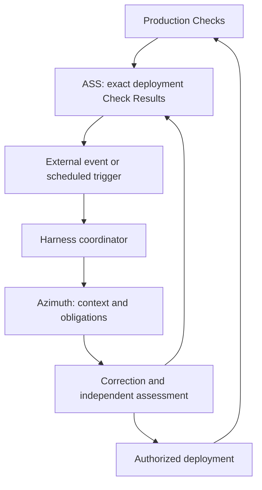

# Intended assurance control plane architecture

Status: **intended architecture**, recorded from the October 2026 architecture discussion. This document describes product direction and agreed responsibility boundaries. It introduces no executable contract, accepted model transition or new command. Current behavior remains governed by implementation and contracts; see [framework.md](framework.md), [verification-workflow.md](verification-workflow.md) and [assurance-reviews.md](../contracts/assurance-reviews.md).

## Purpose

Azimuth is intended to be an **assurance control plane for software development and operation**. It connects product obligations, implementation, execution evidence, independent assessments and accountable decisions. It makes required work and conditions for progression explicit while external execution environments perform the work.

The team should be able to reconstruct what it can justify believing about an exact system state, why it proceeded despite a gap, and whether a subsequent correction resolved the original problem. Assurance is bounded by declared coverage, credible methods and available evidence; it is not a proof of general product correctness or a single quality score.

## Responsibility boundaries

| Component | Responsibility |
| --- | --- |
| Repository Azimuth account | Authoritative product intent, design, verification methods and Check–Scenario relationships; accepted changes to those definitions. |
| Azimuth tooling | Assemble pinned context, validate structure and dependencies, plan bounded verification execution, and expose assurance obligations. Intended workflow interfaces also identify eligible work and progression conditions. |
| Assurance State Service (ASS) | Preserve submitted execution facts, independent assessments and authority history; compute exact-Verification-Target Assurance State. Intended extensions preserve assurance-related decisions and resolution history. |
| Development harness | Execute engineering and review tasks using agents, models, tools and repository context; enforce execution permissions, manage delegation, retries and recovery. |
| Verification tools and adapters | Execute enrolled Checks and capture Check Results with exact Verification Targets and provenance. Production probes are one execution form. |
| Humans with appropriate authority | Resolve product ambiguity, approve intent changes, grant bounded exceptions, authorize actions outside existing permissions and accept changes where required. |

A **development harness** is the execution environment that turns engineering tasks into bounded agent and tool work. It supplies context, instructions, models, tools, isolation, permissions, delegation and execution telemetry. Codex can serve as that environment. A separate runner may dispatch work to several harness products later.

Azimuth remains harness agnostic: task meaning and output requirements do not depend on a vendor's session identifiers, agent APIs or internal reasoning format. Execution backends may differ in capability; an unsupported guarantee must remain visible rather than be assumed satisfied.

## Initial execution arrangement

Start with one Codex coordinator calling Azimuth tooling, delegating bounded implementation and independent review tasks, collecting outputs and submitting results. The user supplies intent, missing external inputs, permissions and acceptance decisions rather than operating the CLI as a routine requirement.

Workers may perform independent local validation concurrently. The coordinator owns shared workflow progression and submissions. A single coordinator does not establish review independence: reviewer context, permissions, authorship separation and provenance need explicit treatment.

Distributed workers can be supported later without making Azimuth their scheduler. Task claiming, leases, queues, worker assignments, retry budgets and interrupted-task recovery belong to the harness or workflow runner. ASS owns assurance facts and decisions rather than worker scheduling state.

## Information exchanged with the harness

The intended interface has three parts. Their wire formats and command syntax remain open.

### Bounded work request

Azimuth prepares a task objective with project and change context, exact target identity and relevant fingerprints, repository and evidence inputs, constraints, required output contract and execution guarantees. Requests distinguish implementation, method review, applicability review, Requirement Judgment and corrective work.

Pinned context is a starting packet. The worker may inspect additional repository or deployment information, but must report missing or contradictory dependencies. ASS supplies recorded facts and assessments; repository context remains necessary for engineering and review.

### Structured work result

The harness returns artifacts, execution provenance and the required result record. A completed rejected assessment is a valid adverse result. A crashed worker, malformed output, wrong target or unmet independence requirement is an execution or contract failure and must be handled separately.

Actionable findings should identify the affected proposition or method, the problem and supporting basis. The current compact review contract has a rationale and supporting artifacts; structured correction findings are an intended extension, not fields accepted by that contract today.

### Eligible work and progression conditions

Azimuth should expose outstanding obligations, eligible actions, dependencies and blockers. Independent tasks may be eligible simultaneously. It should not force all work through a single sequential next action.

`azimuth workflow next` now implements this boundary for an explicitly configured finite task graph; `workflow update` records conditional result transitions. See [the workflow contract](../contracts/workflow.md) for the implemented increment and remaining integration limits. A harness chooses how to execute eligible work and applies its own permission and scheduling controls. CI can enforce the same completion conditions at a repository boundary.

Readiness and permission are separate. Evidence can establish that a task is ready without authorizing production access. An instruction file guides an agent but cannot by itself enforce tool permissions or reviewer isolation.

## Development and correction loop

1. Read approved intent, design and verification obligations from repositories.
2. Implement and capture realization and verification sites.
3. Validate the prospective account against complete relevant source observations.
4. Qualify applicable Check methods through independent review, potentially before execution.
5. Execute Checks against exact Verification Targets and retain satisfied, violated and inconclusive Check Results and measurement failures.
6. Review the applicability of particular Check Results to Check–Scenario contributions.
7. Perform required independent Requirement Judgments over current dependencies and visible gaps.
8. Correct targeted deficiencies and reassess affected dependencies.
9. Validate readiness and cross the explicit acceptance boundary.

Routine Requirements retain their current exemption from independent evidence reviews. The loop does not create universal review obligations merely by describing available activities.

| Result | Expected response |
| --- | --- |
| Rejected Method Qualification | Correct the method, oracle, inputs or instrumentation; prepare refreshed context and obtain independent reassessment. |
| Rejected Applicability Decision | Correct the binding or obtain appropriate evidence; reassess applicability without unnecessarily requalifying an unchanged method. |
| Violated or unresolved Requirement Judgment | Address implementation defects, missing evidence or review gaps; bring intent problems to a responsible intent decision. |
| Invalid review output | Repair the review submission or repeat the review task; do not treat it as a substantive rejection. |
| Execution failure | Diagnose, retry or escalate under bounded harness execution policy. |

Changed relevant definitions invalidate their dependent assessments. Unrelated changes and ordinary reruns do not require all reviews to restart. The rejected decision remains in history; reassessment must not silently overwrite it.

The harness bounds correction attempts and escalates repeated failure. Product ambiguity or a defective obligation must not be resolved by quietly weakening the specification.

## Production maintenance loop

Production telemetry becomes assurance evidence through an enrolled Check and its capture contract. An ordinary operational alert does not automatically establish a Scenario or Requirement conclusion.

An external event or schedule starts or resumes the coordinator. ASS storing an adverse fact does not itself launch an agent. Durable triggering, deduplication and execution recovery belong to integration and harness infrastructure.

The coordinator retrieves the exact affected Verification Target, relevant evidence and repository context; diagnoses the problem; prepares a correction; obtains required reviews; and deploys within granted authority. Deployment provenance links source and artifact Verification Targets to the resulting deployed Verification Target without making their Check Results interchangeable.

Restoring already approved behavior may be autonomous within explicit limits. Changing intended behavior requires an accountable intent decision. Successful editing, verification in another environment or deployment alone does not close a production finding.

Closure requires Check Results for the corrected deployment and the applicable independent assessments. Adapters submit those facts, reviewers submit their decisions, and ASS exposes the resulting state and supporting history. Missing Check Results, stale reviews, failed controls and evidence for another Verification Target leave resolution unestablished.

## Decision handling within ASS

Decision handling is an ASS capability. There is no separate top-level Decision Workbench concept or required service boundary. The UI may present a Decisions section.

A human decision is required when evidence alone cannot choose the next permitted action: changing intent, granting a bounded release exception, authorizing consequential production action outside existing permissions, or choosing among operational trade-offs.

The intended interface groups a situation around a Requirement and exact Verification Target, retaining Scenario-level causes, Check Results, Observations, assessments, requested decision and permitted options. Routine successful Runs should not create human approval requests. Agents may prepare analysis and proposals; the responsible authorized person owns the decision.

Assurance-related decision records belong in ASS. They identify the situation, decision author and authority, chosen disposition, rationale, evidence basis, conditions, scope and any expiry. These fields express intended semantics rather than a finalized schema.

An exception does not turn an unresolved Requirement into a supported Requirement. Authorization to deploy despite missing evidence remains a separate decision, with the gap visible. A decision authorizing an intent change does not itself change the repository specification; the accepted repository transition remains authoritative.

Routine actions within existing authority can reference that authorization without inventing a human decision. Technical access remains enforced by the harness and infrastructure.

## Resolution history

Resolution records belong in ASS because they connect an earlier problem to its correction and the evidence establishing the outcome. A record should reference the original finding and affected Verification Target, correction, resulting deployment Verification Target, supporting Check Results and assessments, declaring actor, rationale and remaining limitations.

A deployed correction is a resolution attempt. Successful resolution requires declared closure conditions. A later recurrence retains the earlier history and introduces a newly assessed problem; it does not erase the prior outcome.

Finding identity, closure conditions, resolution authorization and reassessment semantics need definition before introducing a resolution schema. Current Requirement Status and the resolution of a particular historical finding remain distinct.

## Persistence and observability

ASS preserves completed, deliberately submitted assurance decisions, including rejected assessments. Draft reviews, exploratory agent conversations and unfinished attempts remain harness execution material. Mandatory review workflows should retain their completed adverse decisions rather than submit only eventual successes.

Immutable submitted documents can coexist with typed relational projections for querying Verification Targets, Check Results, Observations, dependencies, decisions and resolutions. Storage projections should follow concrete use cases; package-specific payloads need not all become relational entities.

Harness telemetry supplies model and instruction provenance, duration, cost, retries and human effort where available. Link it to assurance records when useful without making ASS the repository of every agent trace.

Keep assurance conclusions, process health and business value separate. Missing execution, decision backlog, repeated failures and correction latency describe process health. Baselines and comparable outcomes are needed to evaluate value. Accepted reviews or rejection counts alone do not measure agent quality.

## Production inspection context

A model revision owns a separately registered, immutable navigation catalog of
Modules, Requirements, Scenarios and Checks. The catalog is validated against that exact
revision and can be registered before any release exists. Release publication
may attach the same catalog atomically. Descriptive navigation metadata does not
select accepted authority or supply a review.

Each project/environment has explicit, append-only current-deployment selection
history. An authorized publisher conditionally selects a previously recorded
deployment using the preceding selection revision. Recording or accepting a
release does not imply this selection. The selection describes operational
context; it neither proves readiness nor changes accepted model authority. The
controller must designate the actual deployment after rollout, with concurrency
control against a newer selection. Historical deployments remain inspectable.

Exact-system Requirement Status includes an assessor-produced explanation: typed
assessment reasons, current Check–Scenario coverage, selected review identities and
exact evidence references. Supporting evidence is distinguished from matching but
unassessed Check Results. The UI renders this account; it does not derive
applicability from timestamps, labels, source/build provenance or English error
messages. This does not introduce automatic evidence expiry or Requirement Status
transition inference.

## Current capabilities and intended extensions

| Capability | Status in this architecture |
| --- | --- |
| Repository accounts, source linkage, validation, bounded Run execution and package-specific verification | Existing tooling; exact behavior follows current contracts. |
| Target-specific review input, compact independent review records, immutable Run and review histories, explicit authority selection and exact-Verification-Target Assurance State | Existing tooling and service capabilities. |
| Harness-neutral eligible-work interface and correction routing | Implemented for explicit finite task graphs through `workflow next` and conditional `workflow update`; automatic scope discovery, deployment and archive handoff remain outside this increment. |
| ASS human decision situations and accountable disposition records | Intended; no new decision schema or API is defined here. |
| Finding-to-correction resolution records and closure evaluation | Intended; identity and closure rules remain open. |
| Durable production-trigger integration and bounded autonomous maintenance | Intended integration; requires permissions, deployed provenance and recovery contracts. |
| Compact-account Decision Policies and challenge scheduling | Deferred in the current contract; this direction does not implement or finalize them. |

The first practical proof should be one complete Check loop, including an adverse method review and correction, followed by one bounded production maintenance loop. Measure correction effort, review usefulness, missed defects, escalation quality and end-to-end cost before generalizing execution infrastructure.

## Validation through consumer exercises

Concrete workflow rehearsals belong to the consumer repository that owns the change. They should show commands, agent and human actions, adverse assessments, corrections and acceptance boundaries. Generic contracts and tooling developed from those exercises belong here and use synthetic fixtures.

## Open design work

- Define task/result contracts and eligible-work computation without vendor-specific execution state.
- Define independence guarantees and what tooling can validate versus what a harness must enforce.
- Define authority, exceptions and policy-to-action boundaries without confusing assurance readiness with technical access.
- Define findings, closure predicates, resolution records and effects of newer evidence.
- Specify deployed Verification Target capture and provenance links across repository, artifact and production contexts.
- Select trigger and recovery integrations; keep distributed scheduling outside the assurance core.

This direction aligns with validation, accountable governance and evidence-based completion, but does not claim to supply every enterprise governance requirement. Runtime permission hooks, session audit, organization-specific compliance, cost telemetry and business outcome measurement require integrations and further design.

## Git release coordination and deployment reconciliation

The local standard workflow ends with native validated Git-trackable publication inputs and does not contact ASS. A declared release repository owns named requests, exact source selection and desired environment references. Deterministic trusted CI publishes candidate/release records together, generates component-bound deployment values, and retains the actual receipt. Deployment and accepted intent remain separate.

A separate reconciler observes actual runtime image identities, rollout state and configuration; it retries idempotently and records append-only observations with freshness. It does not collect Checks, repair workloads or accept models. Kubernetes/Argo discovery is one adapter, not a required deployment platform. Stale/partial/drifted observation means the current environment is unconfirmed. An authenticated owner can accept an exact release for an explicitly assessed environment through ASS after server preconditions; Git model application/archive remains separate. Automatic acceptance remains deferred.
